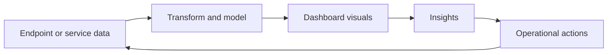

<!-- jr-brand:start -->
<p align="center">
  <a href="https://jannikreinhard.com/">
    
  </a>
</p>
<p align="center">
  <a href="https://jannikreinhard.com/">Website</a> ·
  <a href="https://www.linkedin.com/in/jannik-r/">LinkedIn</a> ·
  <a href="https://x.com/jannik_reinhard">X</a> ·
  <a href="https://www.youtube.com/@jannikreinhard">YouTube</a>
</p>
<!-- jr-brand:end -->

# Intune Power BI dashboards

**Type:** Collection · **Status:** Community project

## Overview

Power BI dashboard templates for Microsoft Intune endpoint analytics and device management reporting.

Power BI Dashboards turns endpoint or operational data into dashboards and reporting views for analysis and decision making.

## Quickstart

1. Review the project context and workflow below.
2. Clone the repository:

   ```bash
   git clone https://github.com/JayRHa/intune-powerbi-dashboards.git
   ```

3. Continue with the setup, usage, or workflow sections below.

## How It Works

Data is exported or connected, transformed into a report model, visualized in dashboards, then reviewed for trends, exceptions, and follow-up actions.



## Intune Reporting Dashboard


## License

This project is available under the terms in [LICENSE](LICENSE).

<!-- jr-brand-footer:start -->
---

[Articles and guides](https://jannikreinhard.com/) · [Repository index](https://github.com/JayRHa/.github/blob/main/REPOSITORIES.md)
<!-- jr-brand-footer:end -->

## Refresh troubleshooting

See the [refresh and compliance troubleshooting guide](docs/troubleshooting.md) for duplicate-key relationships, `0x80040E4E` diagnosis and per-setting compliance details. The guide does not imply the PBIX has been rebuilt or tenant-tested.
